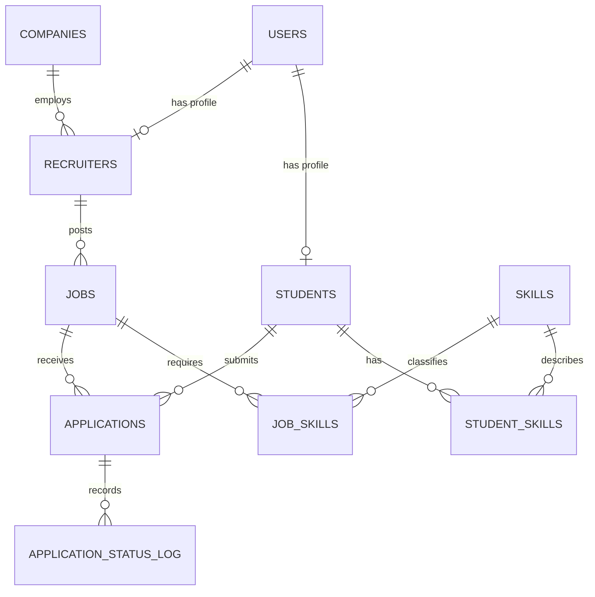

# Job Matcher database schema

The relational source of truth is MySQL 8.0. The schema is defined in
[schema.sql](../schema.sql) and seeded by [seed_data.sql](../seed_data.sql).
Vector embeddings are stored in ChromaDB, not in MySQL.

## Tables and keys

| Table | Purpose | Primary key | Important foreign keys |
|---|---|---|---|
| `users` | Login identity, email, role, password hash | `user_id` | — |
| `students` | Student education and profile data | `student_id` | `student_id → users.user_id` |
| `companies` | Recruiter company records | `company_id` | — |
| `recruiters` | Recruiter-to-company relationship | `recruiter_id` | `recruiter_id → users.user_id`; `company_id → companies.company_id` |
| `jobs` | Job postings and application rules | `job_id` | `recruiter_id → recruiters.recruiter_id` |
| `skills` | Shared skill catalogue | `skill_id` | — |
| `student_skills` | Student/skill many-to-many bridge | `(student_id, skill_id)` | Student and skill foreign keys |
| `job_skills` | Job/skill many-to-many bridge | `(job_id, skill_id)` | Job and skill foreign keys |
| `applications` | Student applications to jobs | `application_id` | `job_id → jobs.job_id`; `student_id → students.student_id` |
| `application_status_log` | Application status history | `log_id` | `application_id → applications.application_id` |

## Relationships

## Integrity rules

- `users.email`, `companies.name`, and `(applications.job_id, applications.student_id)` are unique.
- Role, job type, job status, application status, proficiency, stipend, and match-score `CHECK` constraints are defined in `schema.sql`.
- Foreign keys enforce profile, company, job, skill, application, and status-log relationships.
- Job triggers trim titles, maintain `search_vector`, reject blank titles, and validate deadlines.
- Application triggers create status history and reject applications to missing, closed, or expired jobs.

## Indexes and routines

Indexes include job recruiter/status/deadline/type indexes, application status/student indexes, junction-table skill indexes, the application-log index, and the MySQL `FULLTEXT` index `ft_jobs_search`.

The stored procedure `match_students_for_job(job_id)` returns students ordered by required-skill overlap. Semantic matching is performed separately by ChromaDB using `student_embeddings` and `job_embeddings` with cosine distance.
